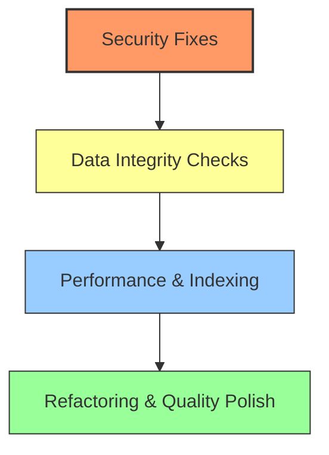

# Code Review: Bilingual Mini CRM MVP

This document provides a comprehensive code review of the Bilingual Mini CRM MVP, covering security, data integrity, database performance, scheduler reliability, and frontend architecture.

---

## 1. Executive Summary

The Bilingual Mini CRM MVP is a well-structured application featuring a **Next.js (React/TypeScript) frontend** and a **FastAPI (Python) backend** utilizing **SQLAlchemy** and **SQLite**. 

### Key Strengths
- **Clean Tenancy Separation:** Isolation by `organization_id` is consistently applied across core tables and query filters.
- **Dynamic Localization Engine:** A unified metadata approach stores raw English keys in the schema and resolves Hebrew labels dynamically at boot, which maintains schema sanity while ensuring a localized RTL user experience.
- **Modular Extension Split:** The segregation of core CRM contact fields from Kiruv-specific parameters (in `contact_mekurav` and `contact_shliach`) keeps tables cohesive.
- **Defensive Maps Integration:** The custom Maps component degrades gracefully to a raw GeoJSON editor in the absence of valid keys, protecting basic functionality.

### Primary Areas for Improvement
1. **Security / Scoping Gaps:** Gaps in API routing allow `shliach` users to access and modify interaction history outside their geographic coverage.
2. **Synchronization Bugs:** Mismatches occur between contact updates and linked login user credentials.
3. **Database & Scheduler Scalability:** In-memory batch processing and unindexed foreign keys pose performance bottlenecks as the database grows.

---

## 2. Security & Access Control (RBAC & Multi-Tenancy)

### 2.1 Critical Vulnerability: Missing Scoping in Interaction Endpoints
In [backend/app/routers/interactions.py](file:///c:/projects/sheepsidebay_crm/backend/app/routers/interactions.py), the `list_interactions`, `create_interaction`, `update_interaction`, and `delete_interaction` endpoints perform basic tenant isolation (`organization_id` check) but completely bypass `shliach` role-based scoping.

- **The Issue:** A user with the `shliach` role can fetch all interaction logs for the entire organization by hitting `GET /api/interactions`. They can also fetch logs for a specific contact (`GET /api/interactions?contact_id=X`) or add/modify logs (`POST`/`PUT`/`DELETE`) for contacts outside their assigned apartments.
- **The Impact:** Unauthorized visibility and modification of contact history, violating the principle of least privilege.
- **Recommendation:** Implement scoping checks in `interactions.py` matching the logic in `contacts.py`:
  ```python
  # In backend/app/routers/interactions.py
  if current_user.role == "shliach":
      ap_ids = _shliach_apartment_ids(db, current_user)
      # Join Contact and filter by apartments covered by the Shliach
      query = query.join(models.Contact).outerjoin(models.ContactMekurav).filter(
          models.ContactMekurav.apartment_id.in_(ap_ids)
      )
  ```

### 2.2 Contact Deletion Access Control
In [backend/app/routers/contacts.py#L384-L393](file:///c:/projects/sheepsidebay_crm/backend/app/routers/contacts.py#L384-L393), any authenticated user can call `DELETE /api/contacts/{contact_id}`.
- **The Issue:** While `shliach` role checks restrict them to deleting contacts they cover, `staff` users face no role checks (since they are not `shliach` and not explicitly gated to `admin`). Consequently, staff can delete any contact in the organization.
- **Recommendation:** Restrict contact deletion to `admin` users or introduce role validation to verify if the user is authorized to perform destructive operations.

### 2.3 Password Hashing & Registration Fallback
The legacy `POST /api/auth/register` endpoint in [backend/app/routers/auth.py#L106](file:///c:/projects/sheepsidebay_crm/backend/app/routers/auth.py#L106) allows creating active admin accounts without email verification. 
- **Recommendation:** Ensure this endpoint is fully deprecated and blocked in production builds (e.g., gated behind an environment check or deleted entirely).

---

## 3. Data Integrity & Synchronization Bugs

### 3.1 Out-of-Sync Linked User Credentials
Creating a contact with type `shliach` auto-provisions a corresponding `User` record via `_provision_shliach_user` in [backend/app/routers/contacts.py#L182](file:///c:/projects/sheepsidebay_crm/backend/app/routers/contacts.py#L182), linking them by email.
- **The Issue:** When an administrator edits the contact's email address through `PUT /api/contacts/{contact_id}`, the change is applied only to the `Contact` model. The linked `User` record (which uses the old email as their username and email) is **not** updated.
- **The Impact:** The Shliach must log in using their old email, and attempts to authenticate via Google using their new email will fail to resolve the user link.
- **Recommendation:** Synchronize credentials updates when editing Shliach contact records.
  ```python
  if contact.contact_type == "shliach" and contact.shliach and contact.shliach.user:
      contact.shliach.user.email = contact.email
      contact.shliach.user.username = contact.email
  ```

### 3.2 Timezone Shift in Birthdays & Yahrzeits
In [backend/app/models.py#L316](file:///c:/projects/sheepsidebay_crm/backend/app/models.py#L316), the `SignificantDate` model defines `special_date` as a `DateTime` column:
`special_date = Column(DateTime, nullable=False)`
- **The Issue:** Birthdays and yahrzeits represent calendar dates (e.g., `1990-05-15`), not specific moments in time. Storing them as timezone-naive `DateTime` values causes SQLite to record them as datetimes (e.g., `1990-05-15 00:00:00`). If the frontend or backend processes these using timezone-aware conversions (e.g., converting to UTC before saving), offset adjustments can easily shift the date backward or forward by a day (e.g., shifting `1990-05-15 00:00:00 +02:00` to `1990-05-14 22:00:00 UTC`).
- **Recommendation:** Change the column type from `DateTime` to `Date` in the database schema:
  ```python
  from sqlalchemy import Date
  special_date = Column(Date, nullable=False)
  ```

### 3.3 Picklist Constraint Validation Bypass
In [backend/app/picklist_utils.py#L50-L64](file:///c:/projects/sheepsidebay_crm/backend/app/picklist_utils.py#L50-L64), `validate_picklist_value` validates input values:
```python
options = active_values(db, organization_id, field_key)
if options and value not in options:
    raise HTTPException(...)
```
- **The Issue:** If `options` is empty (for example, if all picklist values for `field_key` are soft-deleted or none have been seeded for that organization), the `if options` condition is false. As a result, the check is skipped, allowing **any** arbitrary string value to be written to the database.
- **Recommendation:** Ensure validation is enforced if the picklist is expected to contain options:
  ```python
  # Raise an error if value is supplied but no active options exist, or enforce strict picklist registration
  if value is not None and value not in options:
      raise HTTPException(...)
  ```

---

## 4. Performance & Scalability Optimization

### 4.1 Missing Database Indexes on Foreign Keys
While indices are declared on most primary lookup paths in [backend/app/models.py](file:///c:/projects/sheepsidebay_crm/backend/app/models.py), some high-frequency foreign keys are missing index optimizations:
- **`interactions.contact_id`** & **`interactions.created_by`**: Contact views load their history timeline on every open. As logs grow, querying interactions without an index forces a full table scan.
- **`contact_mekurav.contact_id`**: Although marked `unique=True` (which implicitly creates a unique index in SQLite), explicitly adding `index=True` guarantees optimization path resolution across engines.
- **Recommendation:** Add indices to all foreign keys subjected to filter joins:
  ```python
  contact_id = Column(Integer, ForeignKey("contacts.id"), nullable=False, index=True)
  created_by = Column(Integer, ForeignKey("users.id"), nullable=False, index=True)
  ```

### 4.2 Background Scheduler Memory Overhead
In [backend/app/scheduler.py#L91](file:///c:/projects/sheepsidebay_crm/backend/app/scheduler.py#L91), the periodic `scan_reminders` task queries all reminders:
```python
reminders = (
    db.query(models.SignificantDateReminder)
    .filter(models.SignificantDateReminder.channel == "email")
    .all()
)
```
- **The Issue:** The query retrieves *every* email reminder in the database. Inactive reminders (`sd.is_set_reminder = False`) are discarded afterward in Python. As the database grows to thousands of contacts, this creates a major memory and CPU overhead every 5 minutes.
- **Recommendation:** Perform database-level filtering and join optimizations:
  ```python
  reminders = (
      db.query(models.SignificantDateReminder)
      .join(models.SignificantDate)
      .filter(
          models.SignificantDateReminder.channel == "email",
          models.SignificantDate.is_set_reminder == True
      )
      .all()
  )
  ```

### 4.3 Transactional Boundary Gaps in Background Task
In the same `scan_reminders` function, the loop emails recipients and updates `reminder.last_sent_at` in memory, committing the entire batch to the database at the very end:
```python
for reminder in reminders:
    # ...
    if recipients:
        send_email(", ".join(recipients), "תזכורת", _body(sd))
    reminder.last_sent_at = now
db.commit()
```
- **The Issue:** If the SMTP server fails or a network issue occurs while sending the 10th email, an exception will be raised, triggering a rollback (`db.rollback()`). The database will roll back the `last_sent_at` timestamps for the first 9 reminders, even though those emails **were already sent** to the mail server. In the next scheduler run, the scheduler will re-send those same 9 emails.
- **Recommendation:** Isolate transaction scopes inside the loop or process reminders in atomic sub-transactions:
  ```python
  for reminder in reminders:
      try:
          if recipients:
              send_email(", ".join(recipients), "תזכורת", _body(sd))
          reminder.last_sent_at = now
          db.commit() # Commit each notification individually
      except Exception as e:
          db.rollback()
          logger.error(f"Failed sending reminder {reminder.id}: {e}")
  ```

---

## 5. API & Infrastructure Code Quality

### 5.1 SMTP Connection Hanging Risk
In [backend/app/core/email.py#L31](file:///c:/projects/sheepsidebay_crm/backend/app/core/email.py#L31), `smtplib.SMTP` is initialized without a timeout:
```python
with smtplib.SMTP(settings.smtp_host, settings.smtp_port) as server:
```
- **The Issue:** If the SMTP host is unresponsive or blocked by firewalls, Python's `smtplib` will block the thread indefinitely. If this occurs during user signup or verification, the API worker thread will hang, degrading service responsiveness.
- **Recommendation:** Add a short timeout (e.g., 5-10 seconds) to connection calls:
  ```python
  with smtplib.SMTP(settings.smtp_host, settings.smtp_port, timeout=10) as server:
  ```

### 5.2 Deprecated `datetime.utcnow()` Usage
SQLAlchemy defaults and scheduler timestamps in `models.py`, `scheduler.py`, and `main.py` rely on `datetime.datetime.utcnow`.
- **The Issue:** `utcnow()` has been deprecated in Python 3.12+ because it returns timezone-naive datetimes representing UTC, which can cause subtle zone offset calculation bugs when compared against local zones.
- **Recommendation:** Upgrade definitions to use timezone-aware datetime or standard zone offset wrappers:
  ```python
  from datetime import datetime, timezone
  
  # Python 3.12+ standard pattern
  created_at = Column(DateTime, default=lambda: datetime.now(timezone.utc))
  ```

---

## 6. Frontend Architecture & UX Review

### 6.1 Custom RTL DatePicker Analysis
The application implements a dependency-free custom date picker ([frontend/components/DatePicker.tsx](file:///c:/projects/sheepsidebay_crm/frontend/components/DatePicker.tsx)) to handle RTL rendering cleanly.
- **Refinement:** The date parser uses client-local hours by calling `new Date(y, m - 1, day)`. If user systems mismatch backend timezones, date alignments may display slightly skewed. Reconciling inputs using ISO date strings (without timezone attachments) keeps displays consistent.

### 6.2 Maps Performance & Asset Fallbacks
- **Strengths:** Using raw Google Maps classes in `AreaPolygonMap` instead of unstable wrapper packages is a robust design that prevents standard React re-render crashes.
- **Refinement:** When polygons are edited, listeners (`set_at`, `insert_at`, `remove_at`) are attached directly to the path array. Ensure older references are cleared when `AreaPolygonMap` is unmounted to prevent memory leaks in long-running browser sessions.

---

## 7. Recommended Action Plan



### High Priority (Immediate Action)
- [ ] Add `shliach` role validation and scoping filters to all endpoints in `interactions.py`.
- [ ] Align credential updates on `PUT /api/contacts/{contact_id}` to synchronize Shliach `User` email records.
- [ ] Restrict `DELETE` endpoints to administrators or introduce access scoping.

### Medium Priority (Optimizations)
- [ ] Add indices to `interactions.contact_id` and `interactions.created_by` in `models.py`.
- [ ] Add database-level filters to `scan_reminders` to avoid loading inactive reminder definitions.
- [ ] Implement individual transaction commits inside `scan_reminders` to prevent duplicate emails upon SMTP failures.
- [ ] Migrate `SignificantDate.special_date` to a database `Date` column type to prevent timezone shifts.

### Low Priority (Infrastructure & Polish)
- [ ] Add a `timeout` argument to the `smtplib.SMTP` constructor inside `email.py`.
- [ ] Replace deprecated `datetime.utcnow()` calls with `datetime.now(timezone.utc)`.
